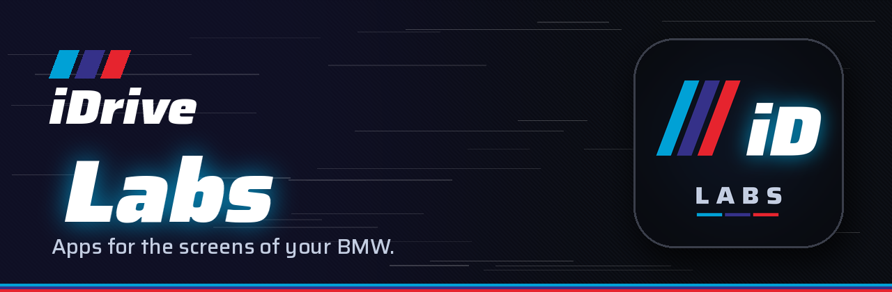

  

<b>Apps for the screens of your BMW.</b> 
Made for iDrive 7 and 8, installed and updated right from the car through the MGU Store.

<a href="https://github.com/idrive-labs/sideways"><b>Sideways</b></a> &nbsp;·&nbsp; live drift angle, chained scoring, replays and a worldwide leaderboard <b>Beta:</b> <a href="https://github.com/idrive-labs/sideways/discussions/1">try it and tell us how it drifts</a>

Add the source once in the MGU Store, and every app arrives with its updates:

<code>idrive-labs/mgu-apps</code>

Unofficial. Not affiliated with or endorsed by BMW AG.

