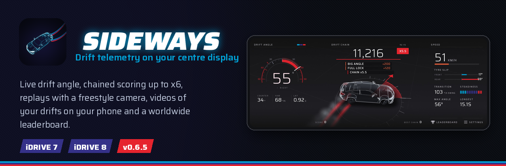
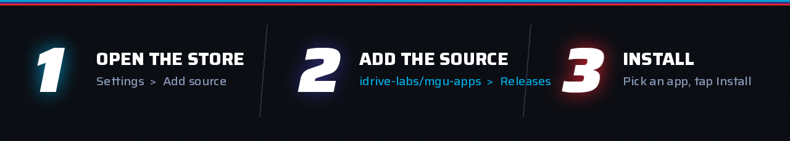

  

  <b>Native apps and real-time telemetry for BMW iDrive 7 &amp; 8 head units.</b> 
  Installed and updated directly from the car through the MGU Store.

  
  
  

---

  <a href="https://github.com/idrive-labs/sideways"><b>Sideways</b></a> &nbsp;·&nbsp; live drift angle, chained scoring, 3D replays, QHD video export &amp; worldwide leaderboard 
  <b>Beta:</b> <a href="https://github.com/idrive-labs/sideways/discussions/1">try it and tell us how it drifts</a>

---

Add the source once in the MGU Store, and every app arrives with its updates:

<code>idrive-labs/mgu-apps</code>

### Repositories

| Repository | Description |
|---|---|
| **[idrive-labs/sideways](https://github.com/idrive-labs/sideways)** | Drift telemetry, Kalman-filtered slip estimation, OpenGL ES 3D replay engine &amp; cloud leaderboard |
| **[idrive-labs/mgu-apps](https://github.com/idrive-labs/mgu-apps)** | Official MGU Store app catalog &amp; release distribution source |

---

  Built by <a href="https://github.com/jarnesence">Járn</a> · Unofficial. Not affiliated with or endorsed by BMW AG.

